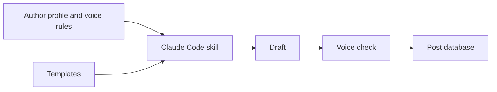

# Content OS

System for running a personal brand with an AI assistant. It keeps the author's voice, positioning and offers in one place, and a Claude Code skill uses them to write posts and video scripts that sound like the author.

## The problem

AI tools write generic text. Every post needs long prompts and many edits before it sounds like the real person.

## What I built

- A structured author profile: voice rules, typical phrases, banned phrases, positioning and offers.
- Templates for Telegram posts and short video scripts.
- A Claude Code skill that reads the profile and templates, drafts a post, and checks it against the voice rules.
- A content plan and a post database in Obsidian.

## How it works

## Stack

Claude Code skills, Markdown, Obsidian.

## My role

I designed the system and wrote the skill.

## Code

The source code is private. I can walk you through the project on a call.

## License

All rights reserved, see [LICENSE](LICENSE).
